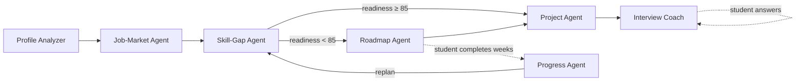

# CareerPilot AI

A multi-agent AI career mentor that closes the skill–job gap for engineering students.
Built for the **IBM SkillsBuild – AICTE Machine Learning & Applied AI Internship 2026**.
Theme: **UN SDG 8 – Decent Work & Economic Growth** (problem: skill–job mismatch).

**Live app:** https://careerpilot-ai-agents.streamlit.app/

## What it does

Upload a resume (or type your skills), pick a target role, and seven LLM-powered agents work on one shared student profile:

| # | Agent | What it does | Tools |
|---|---|---|---|
| 1 | **Profile Analyzer** | Reads the resume, extracts skills and projects, rates each skill beginner/intermediate/advanced with evidence | `resume_parser` (PDF → text) |
| 2 | **Job-Market Agent** | Finds the 10–14 skills employers ask for in the role and scores their importance | `adzuna_job_search` (live postings, optional), `skill_frequency`, curated baseline |
| 3 | **Skill-Gap Agent** | Semantically matches the profile to each market skill (have / partial / missing) and computes an importance-weighted readiness score | — |
| 4 | **Roadmap Agent** | Builds a week-by-week plan that fits the student's weekly hours, highest-priority gaps first | — |
| 5 | **Project Agent** | Recommends 3 portfolio projects that close the most gaps, with build steps and a resume bullet | — |
| 6 | **Interview Coach** | Writes 6 personalised questions and grades the student's typed answers (score, missing points, model answer) | — |
| 7 | **Progress Agent** | Reviews completed weeks + confidence, updates the profile, and decides whether to re-plan | — |

### Orchestration



- All agents read and write one shared `state` (the student's case file).
- The **Orchestrator** routes: strong candidates skip the roadmap and go straight to projects and interview practice.
- **Closed feedback loop:** when the student reports progress, the Progress Agent marks skills as acquired, and if it decides to re-plan, the Skill-Gap and Roadmap agents run again on the updated profile, so the readiness score moves.
- Every step is logged in the **Agent trace** view: which agent ran, which tool it used, LLM calls and time taken.

### Design choices

- **LLM for judgement, code for numbers.** The LLM decides which skills match and writes plans and feedback; the readiness score and job-posting frequencies are computed in Python, so they are consistent and explainable.
- **Validated JSON.** Every agent asks for JSON with required keys; malformed replies are retried once with the error message.
- **Provider-agnostic.** Gemini and Groq both use the OpenAI-compatible API; if a model is retired, the client falls back to the next one.

## Tech stack

Python · Streamlit · Google Gemini / Groq (Llama) via OpenAI-compatible API · pypdf · pandas · Adzuna Jobs API (optional) · pytest

## Run locally

```bash
pip install -r requirements.txt
cp .streamlit/secrets.toml.example .streamlit/secrets.toml   # then paste your free Gemini key
streamlit run app.py
```

Get a free Gemini key at https://aistudio.google.com/apikey (or a Groq key at https://console.groq.com/keys).
Without a key on the server, the app asks for one in the sidebar.

## Tests

```bash
pip install -r requirements-dev.txt
python -m pytest -q
```

The tests run the full agent pipeline, orchestrator routing, re-planning loop and JSON retry against an offline mock LLM, and test the real LLM client (model fallback, bad key) against a local fake API server. No API key needed.

## Project structure

```
app.py               Streamlit UI
orchestrator.py      Agent routing + feedback loop
llm.py               LLM client (Gemini / Groq), JSON validation, model fallback
agents/              One file per agent
tools/               resume_parser, job_search (Adzuna + frequency)
data/                Curated role → skill baseline
tests/               pytest suite + mock LLM
```

## Limitations and future scope

- Without an Adzuna key, market importance comes from the LLM plus a curated baseline, not live data.
- Progress lives in the browser session; next step is user accounts with a database.
- Planned: WhatsApp/email reminders, IBM watsonx support, college dashboard for placement cells.

## Author

Shivam – B.Tech Computer Engineering, J.C. Bose University of Science & Technology, YMCA, Faridabad
